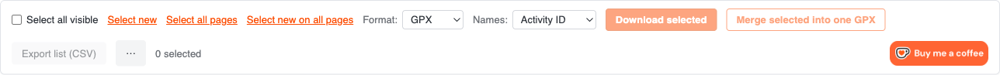
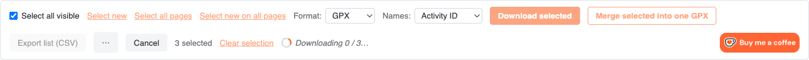
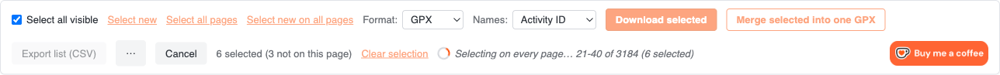
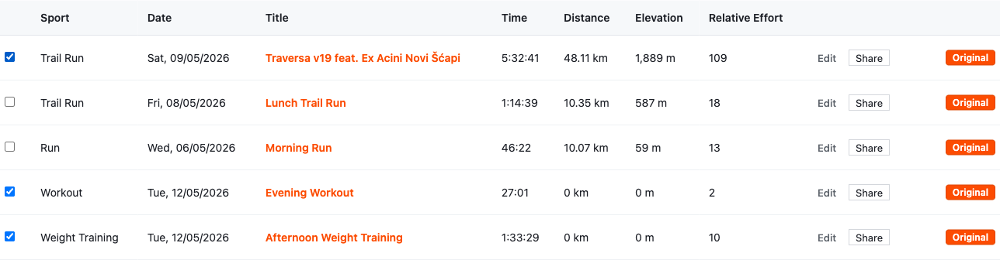
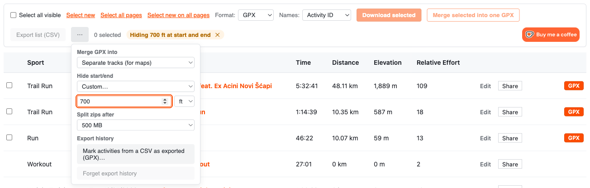

# Strava Bulk GPX Export

[](https://github.com/mladimatija/strava-bulk-gpx/actions/workflows/ci.yml)
[](LICENSE)
[](package.json)
[](https://ko-fi.com/D1D51ZGOQK)

A small Chrome extension that adds **bulk export** to Strava's _My Activities_ page. Filter or search the list however you like in Strava's own UI, then download many activities at once - as individual files or zipped together. Choose between **GPX** (route), **TCX** (route + HR/cadence/power), or **Original** (the exact file you uploaded - `.fit`, `.gpx`, `.tcx`, …).

> **Not affiliated with Strava, Inc.** "Strava" is a trademark of Strava, Inc.

## Screenshots

<!--
These PNGs are generated automatically by `npm run test:screenshots`
(Playwright drives the fixture page in tests/fixtures/, takes one screenshot
per state, writes them here). If you see broken-image icons, you haven't run
that command yet.
-->

| Toolbar                                  | Per-row buttons                                  | Bulk download                               |
| ---------------------------------------- | ------------------------------------------------ | ------------------------------------------- |
|  |  |  |

| Selecting across pages                                    | Indoor activities in Original mode                                          | The ⋯ menu                               |
| --------------------------------------------------------- | --------------------------------------------------------------------------- | ---------------------------------------- |
|  |  |  |

---

## What it does

When you open <https://www.strava.com/athlete/training>, the extension:

- Adds a small toolbar above the activity table with a **Select all visible** checkbox, **Select new**, **Select all pages** and **Select new on all pages** buttons, a **Format** dropdown (GPX / TCX / Original), a **Names** dropdown, a **Download selected** button, a **Merge selected into one GPX** button, an **Export list (CSV)** button, and a **⋯** menu.
- Adds a checkbox at the start of every row and a per-row export button at the end. The button's label tracks the format dropdown - it reads **GPX**, **TCX**, or **Original** depending on what's selected. Shift-click a second checkbox to select (or deselect) every row in between.
- Keeps your selection while you page through, search or filter in Strava's UI, so one download can cover activities from several pages. The count shows how many selected activities aren't on the current page; **Clear selection** drops them all. The selection also survives reloading the page - for a day after you last changed it, and not once it's been fully downloaded as a zip, so leftovers don't join the next backup.
- **Select all pages** pages through the whole list for you with Strava's own ← → buttons - back to the first page, then on to the last - and selects every activity on the way. It covers whatever the list shows, so search or filter first to scope it (a year, a sport, a keyword). Strava shows 20 activities a page, so a few thousand activities take a couple of minutes; **Cancel** stops it and keeps what's selected so far. Only Strava's own list pages load - no activity files are fetched until you download.
- Remembers which activities you've exported, per format: a ✓ appears beside the row button (hover it for the date), and **Select new** picks only the rows on the page you haven't exported in the current format yet; **Select new on all pages** does the same across the whole list. A weekly backup is **Select new on all pages** → **Download selected**. The **⋯** menu can mark the activities in an earlier `activities.csv` (from one of these zips, or from Strava's account archive) as exported, or forget the history.
- Click the row button → one file lands in your Downloads in the chosen format.
- Click **Download selected** with one activity selected → one file (no zip).
- Click **Download selected** with several activities selected → a `.zip` containing one file per activity, plus an `activities.csv` listing each activity's table columns (date, title, time, distance, …), its date as `YYYY-MM-DD` (Strava's own Date column is display text that doesn't sort), and its file name in the zip. The zip itself is named `strava_<format>_<date>.zip` so different batches don't collide in your Downloads folder.
- Large downloads are split into several zips - `strava_<format>_<date>_part1.zip`, `_part2.zip`, … - each saved as soon as it's full, so a backup of thousands of activities never has to fit in the browser's memory at once. Chrome lets a site start only one download without a click, so from the second part on a **Save part N** button appears, and fetching waits until you click it. **⋯ → Split zips after** sets the size (250 MB, 500 MB by default, 1 GB, or never), counted before compression; each part has its own `activities.csv`, and file names are unique across all the parts, so they can be extracted into one folder. Cancelling keeps the parts already saved.
- Click **Merge selected into one GPX** → a single `strava_merged_<date>.gpx` containing one `<trk>` per activity, in chronological order. Useful when you want a multi-day trip rendered as one track collection in RideWithGPS / Gaia / Komoot, or archived as a single file.
- Set **⋯ → Merge GPX into → One activity (for re-upload)** and the button becomes **Join selected into one activity** → `strava_joined_<date>.gpx` with a single track and one segment per activity, in time order. That's the shape to upload back to Strava as one activity - say, a ride you accidentally stopped and restarted. Delete the original activities first: while the earliest one exists, Strava rejects the joined file as a "duplicate of" it (checked on strava.com in November 2026). Deleting them also deletes their kudos and comments. Activities that overlap in time are refused.
- Set **⋯ → Merge GPX into → GeoJSON (for web maps)** and the button becomes **Merge selected into GeoJSON** → `strava_merged_<date>.geojson`: a FeatureCollection with one line per activity, in time order, each carrying the activity's id, name, sport, start time and Strava URL. It loads directly into web maps (Leaflet, MapLibre, geojson.io) and GIS tools such as QGIS. Heart rate and other sensor data are left out - GeoJSON has no standard place for them.
- In TCX mode the button reads **Merge selected into one TCX** → `strava_merged_<date>.tcx`: one activity with each selected activity as a lap, in time order, with distances carrying on from one to the next. In Original mode the merge button is disabled, with a tooltip explaining why (original uploads are mostly binary FIT files).
- **⋯ → Hide start/end** hides the locations within 200 m, 500 m, 1 km or a **Custom…** distance of each activity's start and end before saving a GPX or TCX. A custom distance is typed in metres or feet - feet by default where your browser's locale measures in feet - and switching the unit keeps the number you typed. Strava's own map-visibility hiding only applies on strava.com, so your own exports otherwise show exactly where you start. Points elsewhere on the route that come within that distance of the start or end are hidden too, and the track is split there rather than drawn straight across the gap. GPX files lose those points; TCX files keep them with their time, heart rate, cadence and power, and lose only the position. Trimmed files end in `_trimmed`, carry a note in the file (`<metadata><desc>` in GPX, `<Notes>` in TCX), and don't count as exported. While it's on, a chip on the toolbar says so; it switches itself off when the page reloads. Original files (mostly binary FIT) can't be trimmed.
- **⋯ → Save selected to a folder…** asks for a folder and writes each file straight into it as it arrives - no zip, no **Save part N** clicks, and nothing held in memory beyond the file being written, so it suits backups of any size. With **Sport folders** naming it creates real subfolders. A `strava_activities_<date>.csv` listing what was written goes next to the files. Running it again into the same folder replaces files that are the same size (the same export as before); a different file under a taken name gets a `-2`, `-3`, … suffix instead, so nothing is overwritten by something else. Chrome asks you to confirm the folder, and the access lasts for that page visit only. (It needs the browser's folder picker, which Chromium-based browsers have; where it's missing, the menu doesn't offer it.)
- Click **Export list (CSV)** → `strava_activities_<date>.csv` with the selected activities' table columns. No activity files are fetched.
- While a download or merge runs, **Cancel** stops it without saving anything (beyond zip parts already saved, or files already written to a folder). If Strava rate-limits the requests (HTTP 429), the extension waits as long as Strava asks and retries - for a row's own download button too. If some activities still fail, the toolbar lists each one with the reason, and for zip and folder downloads offers **Retry N failed** to fetch only those. An export Strava doesn't have - it answers with a redirect to a web page - is listed as a failure rather than saved as a file.

The **Names** dropdown (remembered between visits) picks how files are named:

- **Activity ID** (default) - `strava_<id>.gpx` / `.tcx`; for **Original**, the name Strava suggests (which carries the uploaded file's extension).
- **ID + title** - `<id>_<title>.gpx`, e.g. `17421562394_Morning Run.gpx`. The id prefix keeps names unique and sorts files in upload order.
- **Sport folders** - like ID + title, but inside a zip each file goes into a folder per sport (`Run/`, `Ride/`, …). Single-file downloads can't create folders, so they get the ID + title name.
- **Date + title** - `<date>_<title>.gpx`, e.g. `2026-05-09_Morning Run.gpx`, so files sort by when they happened. The date comes from Strava's Date column, which shows it in your display format: day-first and month-first dates are told apart by a day above 12, by the weekday name, or by another row on the page that settles it. Where none of those can, the file gets the ID + title name instead. Same-named files in a zip get `-2`, `-3`, ….

The three formats are Strava's own exports. Its activity-page menu lists Export GPX and Export Original; TCX is served the same way at `/export_tcx`, just not listed there (this extension adds it - see below):

- **GPX** - the route as standard GPX 1.1. Best for mapping tools (RideWithGPS, Gaia, Komoot).
- **TCX** - route plus heart rate, cadence, and power streams. Best for Garmin Connect, TrainingPeaks, or any tool that wants the sensor data.
- **Original** - the exact byte-for-byte file you originally uploaded (`.fit` for most modern head units, `.gpx` from phone apps, etc.). Best for archival or for tools that prefer the manufacturer's native format.

Indoor / no-GPS activities (no distance) only get a checkbox and a button in **Original** mode: Strava has no GPX or TCX for them, but the file you uploaded - a trainer ride's power, a strength session's heart rate - is still there. Switching to GPX or TCX deselects them, and says so. Manual entries have no file at all; they're listed as failures with the reason. Everything else - search, sport filter, date filter, sort, pagination - is Strava's own UI. The extension just hooks into whatever's currently on screen.

On your own activity pages (`/activities/<id>`), the extension also adds **Export TCX** to Strava's "…" menu, right after Export GPX. Strava serves TCX at `/activities/<id>/export_tcx` but doesn't list it in that menu.

## Why it exists

Strava has _Export GPX_ on the individual activity page, and a one-time full-account export buried in account settings. Neither of those is useful when you want:

- All your activities from a specific trip you tagged in the title.
- A keyword-filtered subset (e.g., every `commute` activity).
- A single zip you can hand to RideWithGPS, Gaia, Komoot, your coach, or just archive on disk.
- A single merged `.gpx` that shows every day of a multi-day trip as one continuous track collection.
- A regular backup of everything new since last time - including the indoor sessions - without paging through the list by hand.

The extension fills exactly that gap and nothing else.

## Why a browser extension instead of a hosted service

Two short answers, the rest in [PRIVACY.md](PRIVACY.md):

1. **Trust model.** A hosted service that touched your Strava data would need either your OAuth tokens (Strava's official OAuth API doesn't expose keyword search on the activity list, so you'd lose the search feature) or your session cookie (a privacy issue – the cookie grants full account access, much more than OAuth's scoped permissions). A local extension sidesteps both: nothing leaves your browser.

2. **Rate limits.** Strava's per-app rate limits (100 requests / 15 min, 1,000 / day) are shared across every user of an app. A hosted service for thousands of people would hit them in minutes. An extension makes requests from each user's own browser session – there is no shared bucket.

The extension uses Strava's own native export endpoints:

- `https://www.strava.com/activities/<id>/export_gpx`
- `https://www.strava.com/activities/<id>/export_tcx`
- `https://www.strava.com/activities/<id>/export_original`

These are the URLs behind Strava's own _Export GPX_ and _Export Original_ links on individual activity pages (TCX is served the same way, just not listed). The downloaded files are byte-for-byte identical to what you'd get by clicking those links manually - except merged files, which are built from them, and GPX/TCX files saved with **Hide start/end** on, which are trimmed in your browser and named `…_trimmed.gpx` / `…_trimmed.tcx` so they can't be mistaken for the originals. **Select all pages** doesn't use any other endpoint: it clicks Strava's own pager, and Strava loads its list pages as it would for you. Bulk mode is just N concurrent calls to the chosen endpoint, with the responses compressed into a zip in your browser as they arrive (or written to the folder you picked); a single download is one such call, saved under the chosen name. For the **Original** format the per-file extension comes from the `Content-Disposition` header Strava returns - or, when it has none, from the file itself (FIT, gzip, GPX, TCX) - so a `.fit` from a Garmin and a `.gpx` from a phone end up correctly named in the same zip.

## Install

### From the Chrome Web Store

https://chromewebstore.google.com/detail/strava-bulk-gpx-export/nabkcpkedegngoebodobopcojpahgbba

### From source (developer mode)

```bash
git clone https://github.com/mladimatija/strava-bulk-gpx.git
cd strava-bulk-gpx
npm install         # also installs git hooks via simple-git-hooks
npm run build       # runs prebuild (icons + kofi + type-check) then vite build
```

Then in Chrome:

1. Open `chrome://extensions`.
2. Toggle **Developer mode** on (top right).
3. Click **Load unpacked**.
4. Select the `dist/` folder.

After a `git pull`, run `npm run build` again and click the reload icon next to the extension in `chrome://extensions`.

## Use

1. Log in to <https://www.strava.com> if you aren't already.
2. Visit <https://www.strava.com/athlete/training>.
3. Use Strava's own search and filters to get the list you want.
4. Pick a format from the toolbar dropdown (defaults to **GPX**).
5. Click the per-row button on a single row, or check multiple rows - or click **Select all pages** - and click **Download selected** in the toolbar.
6. For a regular backup, click **Select new on all pages** and then **Download selected**: it picks only the activities you haven't exported in the chosen format yet. For a complete archive, pick **Original** first, so indoor activities are included.
7. To get one combined file instead of a zip, click **Merge selected into one GPX** (or **… one TCX** in TCX mode). See _What it does_ for joining activities into one, and for hiding the start and end of GPX tracks.

Rows can only be checked while they're on screen, but the selection survives Strava's pagination: check rows on page 1, go to page 2, check more, and **Download selected** fetches all of them. It's saved locally too, so a reload doesn't clear it (for up to a day after the last change, and not after it's been fully downloaded as a zip); **Clear selection** does.

## Development

```bash
npm run dev         # vite dev server with HMR
npm run check       # lint + format:check + type-check (CI gate)
npm run lint        # eslint .  /  npm run lint:fix to autofix
npm run format      # prettier --write .  /  format:check for verification only
npm run type-check  # tsc --noEmit; runs automatically as part of prebuild
npm run build       # type-check + production build to dist/
npm run icons       # regenerate icon PNGs from icons/icon.svg
npm run kofi        # refetch Ko-fi button asset into src/kofi-asset.ts
npm run package     # builds and zips dist/ into strava-bulk-gpx.zip for store upload
```

The project layout:

```
.
├── manifest.json           # MV3 manifest: content scripts for My Activities and activity pages
├── tsconfig.json           # strict TS config, bundler-style resolution
├── vite.config.ts          # @crxjs/vite-plugin + inline manifest version sync
├── eslint.config.mjs       # flat config, type-aware TS rules scoped to src/
├── prettier.config.cjs     # 2-space tabs, single quotes, 120 print width
├── icons/icon.svg          # source for the icon; PNGs generated via npm run icons
├── scripts/
│   ├── clean.js            # wipes dist/ before each build
│   ├── build-icons.js      # sharp-based SVG → PNG renderer
│   ├── build-kofi.js       # fetches kofi6.png and emits src/kofi-asset.ts
│   └── build-i18n.js       # emits src/i18n-messages.ts from _locales/en/messages.json
└── src/
    ├── content.ts          # entry: wires the toolbar and rows, runs exports, observes Strava's table
    ├── state.ts            # the content script's state and saved preferences
    ├── table.ts            # reads Strava's table: rows → activities
    ├── distance.ts         # reads a Distance cell in any unit or language
    ├── paging.ts           # Strava's pager, for Select all pages
    ├── toolbar-html.ts     # the toolbar's markup
    ├── activity-page.ts    # adds Export TCX to an activity page's "…" menu
    ├── downloader.ts       # fetching exports; single, zip, folder and merged downloads
    ├── merge.ts            # merging exports into one GPX, TCX or GeoJSON
    ├── zip.ts              # streaming zip writer (fflate)
    ├── folder.ts           # writing into a picked folder (File System Access API)
    ├── csv.ts              # activities.csv / "Export list" generation
    ├── dates.ts            # activity dates from Strava's Date column
    ├── history.ts          # export history (chrome.storage.local)
    ├── selection.ts        # the selection, saved across reloads
    ├── trim.ts             # Hide start/end for GPX and TCX files
    ├── units.ts            # metres/feet for a custom Hide start/end distance
    ├── xml.ts              # small DOM helpers shared by merge and trim
    ├── i18n.ts             # typed t() over chrome.i18n, with English fallback
    ├── i18n-messages.ts    # generated English fallback strings (npm run i18n)
    ├── types.ts            # shared interfaces (ActivityRow, ProgressEvent, …)
    ├── kofi-asset.ts       # generated base64 data URL for the Ko-fi button
    └── styles.css          # toolbar + row styling, sbgx-* namespaced
```

The repo's version of truth is `package.json.version`. `vite.config.ts` reads it at build time, strips any SemVer prerelease tail (Chrome's manifest format doesn't allow `-beta.1` etc.), and writes the result into `manifest.json.version`. Don't edit `manifest.json.version` by hand. To cut a release, follow [Releases in CONTRIBUTING.md](CONTRIBUTING.md#releases): bump in the PR, tag the merge commit after it lands.

### Localization

User-facing strings live in `_locales/<code>/messages.json`. English (`en`) is the source of truth; the manifest's `default_locale` is `en` so any string missing from another locale falls back to it. The Chrome i18n system picks the right locale automatically based on the user's browser language - no flag, no extension setting.

Code calls strings through a typed `t()` helper in `src/i18n.ts`:

```ts
import { t } from './i18n.ts';
btn.textContent = t('downloadSelected');
setStatus(t('downloadingProgress', [String(completed), String(total)]), 'info', { spinner: true });
```

`MessageKey` in `src/i18n.ts` is the compile-time check: a typo in a key is a TypeScript error, not a silent runtime empty-string. It comes from `src/i18n-messages.ts`, which `npm run i18n` generates from `_locales/en/messages.json` - run it after adding or changing an English message. A unit test fails when the generated file is out of date, when a locale is missing a message, or when a translation's `$PLACEHOLDER$`s differ from the English one's.

See [`_locales/README.md`](_locales/README.md) for the list of shipped locales and how to add a new one.

Pre-commit hooks are installed via `simple-git-hooks` + `lint-staged` - they run on `npm install` automatically and lint/format only staged files on each commit.

### Testing

```bash
npm run test:install     # one-time: install Playwright's bundled Chromium
npm run build            # tests run against dist/, so build first
npm test                 # Playwright E2E suite (tests/e2e/*.spec.ts)
npm run test:unit        # Node unit tests for pure modules (tests/unit/*.test.ts) - no build needed
npm run test:screenshots # regenerates docs/screenshots/*.png from the same fixture
```

The E2E tests load the built extension into a real Chromium instance and intercept the `https://www.strava.com/athlete/training` URL to serve `tests/fixtures/strava-training.html` instead - so Chrome thinks the content script is running on Strava, but the page is our own fake table. Activity-page tests do the same for `/activities/<id>` with `tests/fixtures/strava-activity.html`, a copy of the real "…" menu's structure. Export responses are stubbed per test. No real Strava account needed.

The unit tests cover the pure modules directly, and what the browser suite can't reach: date parsing across Strava's display formats (`src/dates.ts`), reading distances in any unit or language (`src/distance.ts`), merging and trimming (`src/merge.ts`, `src/trim.ts`), the CSV, the zip writer, folder writes against an in-memory folder, the message files, and how an export response is classified (`exportProblem`) - Playwright doesn't route the request that follows a redirect, so a redirect to Strava's login page can't be simulated end to end. Node 24 runs them as TypeScript directly; the modules that build XML get a DOM from jsdom (`tests/unit/helpers/dom.ts`).

The folder tests in the browser suite can't answer Chrome's folder picker, so they point the content script's `showDirectoryPicker` at the page's origin-private folder - a real directory handle - and read the files back from there.

`npm run test:screenshots` uses the same fixture to capture the README images into `docs/screenshots/`. The bulk-mode screenshot slows the mocked `/export_gpx` responses so the spinner state stays visible mid-flight.

A note on running the tests: the fixture launches Chromium in its new headless mode (`channel: 'chromium'`) - the full browser without a window, so the suite doesn't pop up windows or take focus while you work, and needs no display on Linux. The old headless shell, which Playwright's plain `headless: true` launches, silently ignores `--load-extension`, and Chrome 137+ additionally requires `--disable-features=DisableLoadExtensionCommandLineSwitch` to permit the flag at all. To watch the tests in a visible window, set `PWTEST_HEADED=1`.

By default the tests use Playwright's bundled Chromium - pinned to whatever Playwright version is installed, reproducible across machines. To run against your installed Chrome stable instead (closer to what end users have but less reproducible), set `PWTEST_BROWSER=chrome`:

```bash
PWTEST_BROWSER=chrome npm test
```

Same flag set, different binary.

## Privacy

See [PRIVACY.md](PRIVACY.md). The short version: the extension has no backend, no analytics, no telemetry. All requests go to `strava.com` and only when you click a download button.

## Like this?

If it saves you time:

[](https://ko-fi.com/D1D51ZGOQK)

Free either way.

## License

[MIT](LICENSE).

## Disclaimer

This extension is not affiliated with, endorsed by, or sponsored by Strava, Inc. It uses the same internal endpoints that Strava's own _My Activities_ page uses, on your behalf, while you are logged in to your own account. Use it for personal data export only. Strava's [Terms of Service](https://www.strava.com/legal/terms) apply to your account and your interactions with their service.
